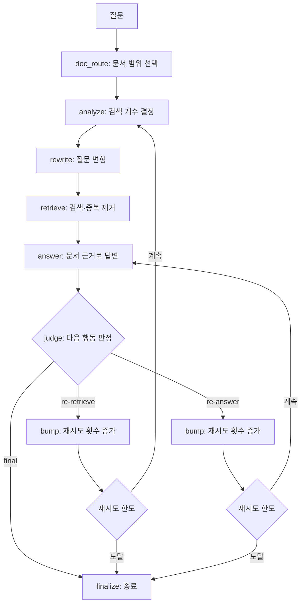

# LLM Study
### 로컬 모델 실행부터 Adaptive RAG와 에이전트 흐름까지

**로컬 LLM, 문서 검색, 도구 호출, 그래프 기반 에이전트의 구성과 동작을 정리한 학습 포트폴리오입니다.**

[English](README.en.md) · [학습 지도](docs/STUDY_MAP.md) · [Adaptive RAG](docs/ADAPTIVE_RAG.md) · [매뉴얼 정리](docs/MANUAL_NOTES.md) · [자료 출처](SOURCES.md)

`Python` · `Transformers` · `Ollama` · `LangChain` · `LangGraph` · `Chroma / FAISS` · `MCP`

## Overview

제공된 LLM 실습 자료와 학습 매뉴얼을 바탕으로 모델 로딩, 프롬프트, RAG, 에이전트 실행 흐름을 정리했습니다. 특히 **질문에 맞는 문서 검색 → 답변 생성 → 근거 판정 → 재검색·재답변 또는 종료** 과정을 노드와 상태로 이해하는 데 초점을 둡니다.

학습 자료의 구현 구조를 설명하는 문서와 모델 로딩 노트북을 공개합니다. 강사용 예제 전체를 자체 개발 코드로 소개하지 않습니다.

## Study Highlights

| 학습 영역 | 정리한 내용 |
|---|---|
| 로컬 모델 | Transformers 모델·토크나이저 로딩, Ollama 호출 예제 |
| 프롬프트·체인 | 프롬프트 구성, 출력 파싱, 구조화된 응답 |
| 문서 검색 | PDF 청크, 임베딩, Chroma·FAISS, 메타데이터 |
| 검색 전략 | 문서 라우팅, Multi-query, 검색 범위 확대 |
| 그래프 에이전트 | 상태 공유, 노드, 조건부 분기, 재시도 제한 |
| 도구 연동 | MCP 클라이언트·서버, 멀티 도구와 협업 구조 |
| 모델 적응·관찰 | LoRA·DoRA 예제, LangSmith 추적 |

## Featured Study: Adaptive RAG



### 핵심 설계 관점

- **검색 범위 관리:** 질문의 키워드로 문서 ID를 선택하고, 검색 결과에 출처·페이지 정보를 유지합니다.
- **적응형 검색:** 첫 검색과 재검색의 전략을 구분하고, 필요한 경우 검색 개수와 질문 표현을 확장합니다.
- **행동 분리:** 근거가 부족하면 재검색하고, 근거가 있어도 답변이 부적절하면 재답변합니다.
- **실행 추적:** 상태와 로그를 통해 각 단계가 어떤 자료와 판단을 사용했는지 확인합니다.

[노드·상태·분기 상세 →](docs/ADAPTIVE_RAG.md)

## Included Notebook

[모델 로딩 실습](notebooks/01_model_loading.ipynb)은 `AutoTokenizer`와 `AutoModelForCausalLM`으로 모델을 불러오는 원본 실습 코드입니다. 실행 출력과 로컬 메타데이터를 제거했습니다. 모델 파일은 포함하지 않았고, 이번 공개 정리 과정에서 모델 다운로드나 추론을 실행하지 않았습니다.

노트북 실행에는 PyTorch·Transformers·Accelerate 등 별도 환경과 모델을 저장할 공간이 필요합니다.

## Study Outcomes

| 정리 자료 | 내용 |
|---|---|
| [학습 지도](docs/STUDY_MAP.md) | 로컬 모델·RAG·에이전트·MCP·미세조정의 관계 |
| [Adaptive RAG](docs/ADAPTIVE_RAG.md) | 상태, 노드, Judge 결과와 재시도 흐름 |
| [매뉴얼 정리](docs/MANUAL_NOTES.md) | 기본 RAG·고정 검색+판정·적응형 흐름 비교 |
| [모델 로딩 노트북](notebooks/01_model_loading.ipynb) | 모델·토크나이저 로딩 코드 |

이 저장소의 결과물은 **학습 정리와 예제 코드**입니다. 매뉴얼의 실행 사례는 구조를 설명하는 자료로 사용하며, 별도 벤치마크 점수나 서비스 운영 실적으로 표현하지 않습니다.

## Repository Layout

```text
LLM-Study/
├── README.md
├── README.en.md
├── notebooks/01_model_loading.ipynb
├── docs/
│   ├── STUDY_MAP.md
│   ├── ADAPTIVE_RAG.md
│   └── MANUAL_NOTES.md
└── SOURCES.md
```
